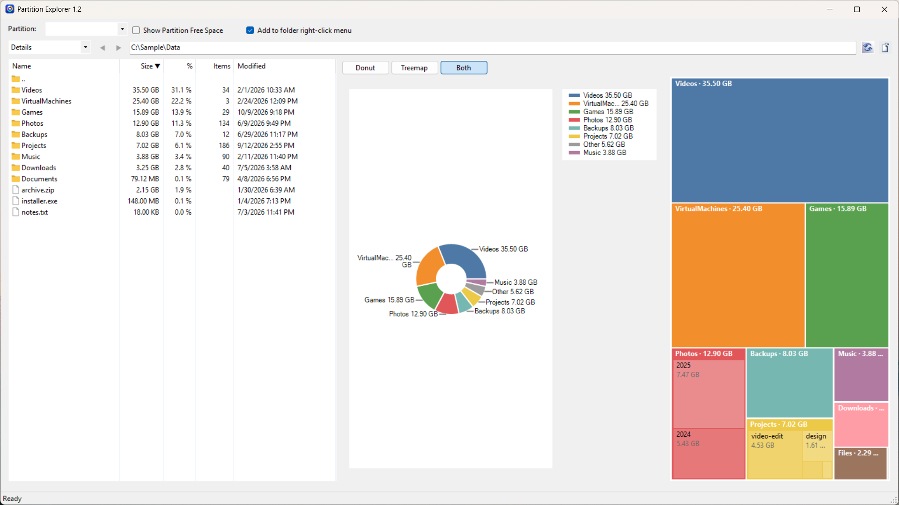
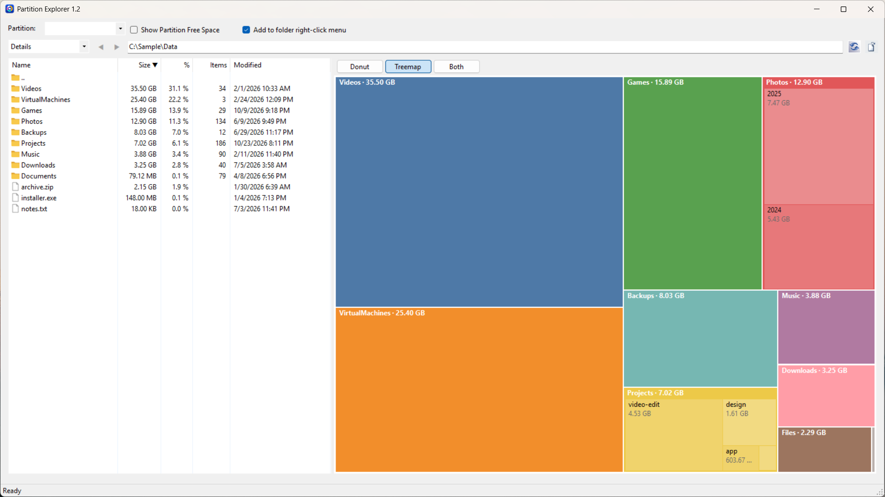
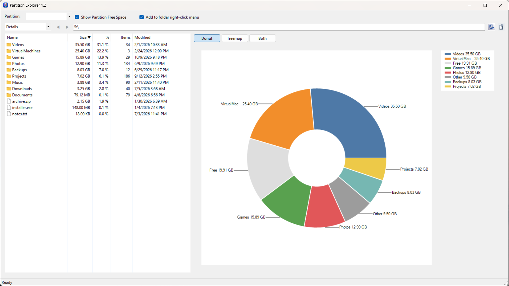
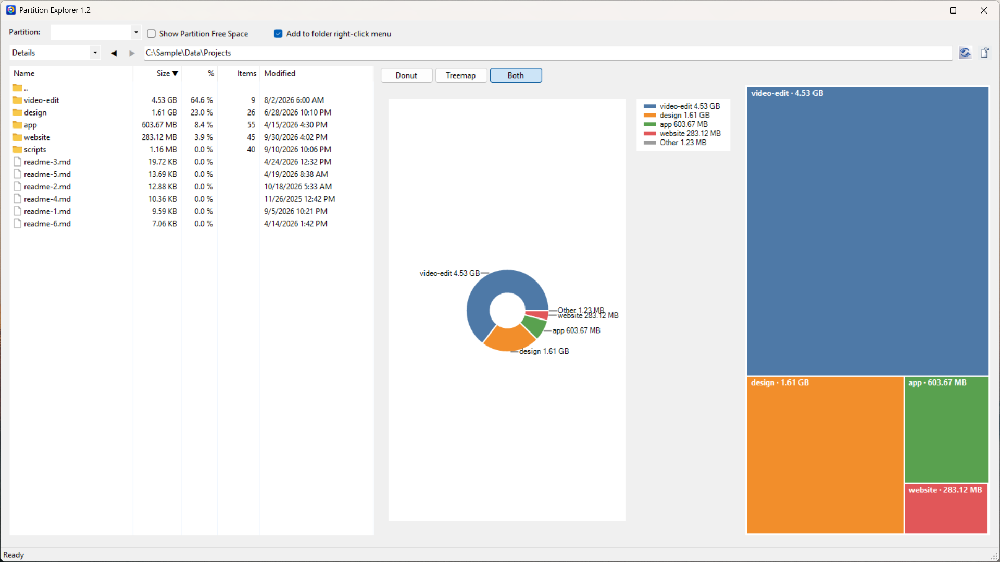
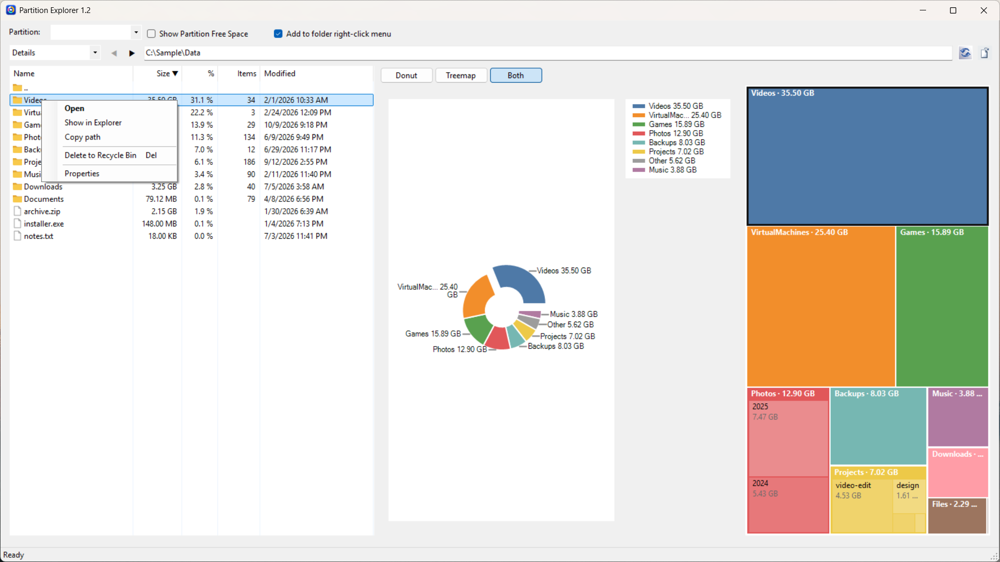

<p align="center">
  
</p>

<h1 align="center">PartitionExplorer</h1>

<p align="center">
  A small Windows app that shows where your disk space went.
</p>

<p align="center">
  <a href="https://apps.microsoft.com/detail/9ndjw6b06x81"></a>
</p>



PartitionExplorer scans a drive or folder and lists every subfolder and file with its total size, so you can find what is filling up a partition and clean it up without leaving the app.

## More screenshots

| | |
|---|---|
|  |  |
| The treemap on its own. Big folders show their subfolders inside. | The donut on a drive root, with the partition's free space shown. |
|  |  |
| Inside a subfolder. Back takes you to where you were. | The right-click menu on an item. |

## Features

- **Details list** with Name, Size, %, Items and Modified columns. Click a column header to sort, and click it again to flip the order.
- **Background scanning.** The window stays responsive while folders are measured, the status bar shows what is being scanned, and a scan can be cancelled at any time. Sizes are cached, so going back to a folder you already scanned is instant.
- **Donut and treemap views** of the current folder. Pick Donut, Treemap or Both, and optionally show the partition's free space. Click a slice or a box to open that folder.
- **Navigation** like Explorer: Back and Forward buttons, a path box you can type into, and the usual keys (Backspace or Alt+Up for the parent folder, Alt+Left and Alt+Right for back and forward, Enter to open, Delete to recycle).
- **Right-click menu** on any item: Open, Show in Explorer, Copy path, Delete to Recycle Bin and Properties.
- **Explorer integration.** Tick "Add to folder right-click menu" to get an *Open in PartitionExplorer* entry on folders in Windows Explorer. It is registered for the current user only, so it needs no admin rights.
- Junctions and symbolic links are marked as links and not followed, so nothing is counted twice. Folders that could not be fully read are flagged, since their size is a minimum.
- A flat, clean look with its own app icon.

## Install

The easiest way is to get it from the [Microsoft Store](https://apps.microsoft.com/detail/9ndjw6b06x81). The Store version includes everything it needs, so you don't have to install .NET, and it updates on its own. You can also download the zip from [Releases](https://github.com/nuksee/PartitionExplorer/releases), or build it yourself as described below.

## Requirements

- Windows 10 or 11.
- The [.NET 8 Desktop Runtime](https://dotnet.microsoft.com/download/dotnet/8.0) to run it, or the .NET 8 SDK to build it.

## Building

With the [.NET 8 SDK](https://dotnet.microsoft.com/download/dotnet/8.0) installed, run this from the repository root:

```
dotnet build PartitionExplorer.sln -c Release
```

The app lands in `PartitionExplorer\bin\Release\net8.0-windows\`. You can also open `PartitionExplorer.sln` in Visual Studio 2022 and build from there.

### Microsoft Store package

`packaging\build-msix.ps1` builds the MSIX package for the Microsoft Store into `packaging\out\`. It publishes the app self-contained, so Store users don't need the .NET runtime, and downloads `makeappx` from NuGet, so no Windows SDK install is needed. It uses the app's Store identity from Partner Center (**Product identity**), so the output can be uploaded as it is:

```
.\packaging\build-msix.ps1
```

To try the package locally, turn on Developer Mode (Settings > System > For developers) and run `.\packaging\build-msix.ps1 -Register`. The Store build doesn't offer the folder right-click menu checkbox, because packaged apps can't write that registry entry.

## Running and sharing

Start `PartitionExplorer.exe` from the release folder. To open a specific folder right away, pass it on the command line:

```
PartitionExplorer.exe "D:\Downloads"
```

To give the app to someone else, copy the **whole** `net8.0-windows` folder, not just the exe: `PartitionExplorer.dll` and the chart library next to it are needed too. The other person needs the .NET 8 Desktop Runtime installed; if it is missing, Windows shows a link to download it when the app starts.

## License

PartitionExplorer is released under the [MIT License](LICENSE).
